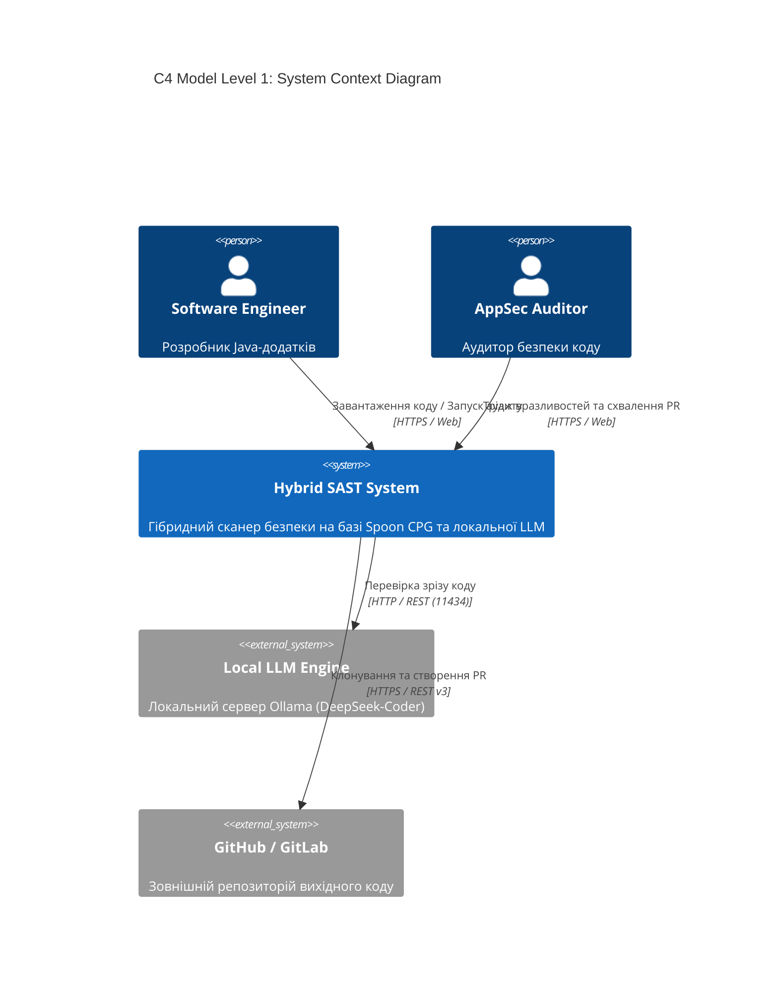
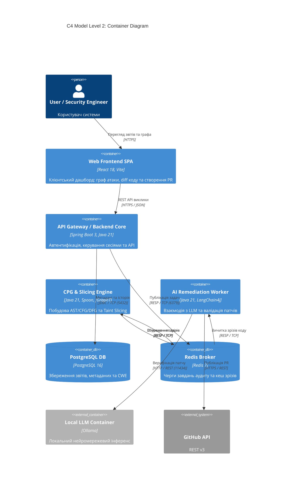
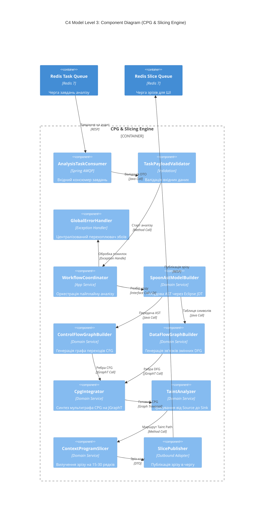

# РОЗДІЛ 2. ПРОЄКТУВАННЯ АРХІТЕКТУРИ СИСТЕМИ

## 2.1. Контекстне та контейнерне моделювання системи (C4 Model: Levels 1–2)
Архітектурне проєктування системи виконано за індустріальною методологією Саймона Брауна (C4 Model) із застосуванням парадигми Diagrams-as-Code у нотації Mermaid.js.

### 2.1.1. Рівень 1: Діаграма системного контексту (System Context Diagram)
Діаграма першого рівня відображає межі системи, користувачів (Person) та зовнішні взаємодії з корпоративними і хмарними сервісами (System_Ext).

* **Трасування та наскрізні зв'язки (Cross-linking):**
  * Спроєктована система **Hybrid SAST System** реалізує функціональну вимогу безпеки [[SRS-FUN-01](../srs.md#2-functional-requirements)] щодо прийому вихідного коду через API або ZIP-архіви.
  * Контейнер **Local LLM Engine** гарантує виконання нефункціональної вимоги конфіденційності [[SRS-NFR-SEC-01](../srs.md#3-non-functional-requirements)] — повне функціонування в On-Premises контурі без витоку даних на сторонні хмарні сервери.
  * Взаємодія з **GitHub / GitLab** забезпечує автоматизовану генерацію безпечних виправлень згідно з вимогою [[SRS-FUN-08](../srs.md#2-functional-requirements)].

---

### 2.1.2. Рівень 2: Діаграма контейнерів (Container Diagram)
Діаграма другого рівня розкриває сервісну декомпозицію системи на окремо контейнеризовані Docker-модулі відповідно до обраного технологічного стеку.

* **Трасування та інженерні протоколи:**
  * Контейнер **CPG & Slicing Engine** базується на затвердженому інженерному рішенні [[ADR-001](./adr/0001-choice-of-technology.md)] щодо використання бібліотек Spoon та JGraphT для розбору коду та побудови графа CPG.
  * Контейнер **AI Remediation Worker** реалізує автоматичний синтез виправлень [[SRS-FUN-06](../srs.md#2-functional-requirements)] та пісочницю компілятора [[SRS-FUN-07](../srs.md#2-functional-requirements)].
  * Брокер **Redis Broker** гарантує високу продуктивність за вимогою [[SRS-NFR-PERF-02](../srs.md#3-non-functional-requirements)] та надійність із Dead Letter Queue згідно з [[SRS-NFR-REL-01](../srs.md#3-non-functional-requirements)].

---

## 2.2. Компонентне моделювання критичного сервісу (C4 Model Level 3: Component)
Для деталізації на компонентному рівні обрано найскладніше ядро системи — бекенд-контейнер **CPG & Slicing Engine**. Архітектуру структуровано за патерном Clean Architecture з чітким розмежуванням обов'язків (Separation of Concerns).

* **Аналіз архітектурної дисципліни шарів (Clean Architecture):**
  * **Inbound Layer:** Компоненти `AnalysisTaskConsumer`, `TaskPayloadValidator` та `GlobalErrorHandler` ізолюють домен від транспортного протоколу черги та забезпечують відмовостійкість за вимогою [[SRS-NFR-REL-01](../srs.md#3-non-functional-requirements)].
  * **Domain Core Layer:** Сервіси `SpoonAstModelBuilder`, `ControlFlowGraphBuilder`, `DataFlowGraphBuilder` та `CpgIntegrator` реалізують алгоритмічний розбір коду та базуються на рішенні [[ADR-001](./adr/0001-choice-of-technology.md)].
  * **Taint & Slicing Services:** Компоненти `TaintAnalyzer` та `ContextProgramSlicer` виконують детерміноване скорочення простору аналізу на 95–98% відповідно до вимоги [[SRS-FUN-05](../srs.md#2-functional-requirements)].

---

## 2.3. Документування архітектурних рішень (Architecture Decision Records)
Усі критичні архітектурні компроміси зафіксовані за міжнародним індустріальним стандартом:
* [ADR-001: Вибір технологічного стеку для синтаксичного розбору, побудови CPG та слайсингу Java-коду](./adr/0001-choice-of-technology.md) — офіційне рішення у статусі `Approved` (порівняльний аналіз Spoon, JavaParser та Joern).
