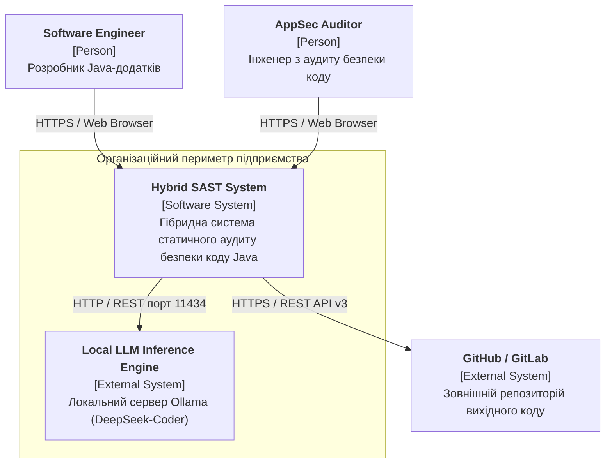
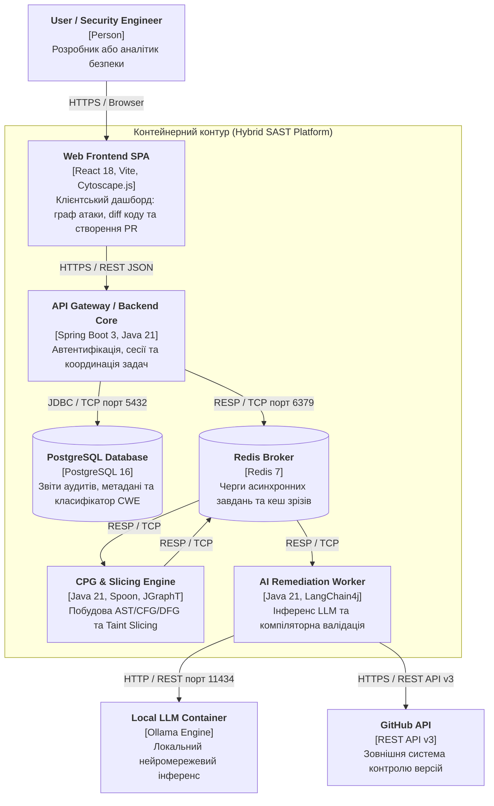
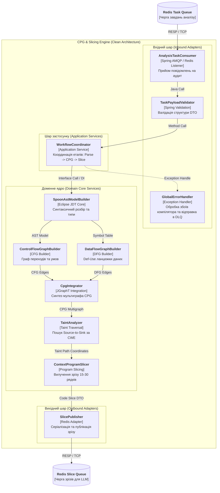

# РОЗДІЛ 2. ПРОЄКТУВАННЯ АРХІТЕКТУРИ СИСТЕМИ

## 2.1. Контекстне та контейнерне моделювання системи (C4 Model: Levels 1–2)
Архітектурне проєктування системи виконано за індустріальною методологією Саймона Брауна (C4 Model) із застосуванням парадигми Diagrams-as-Code у середовищі Mermaid.js.

### 2.1.1. Рівень 1: Діаграма системного контексту (System Context Diagram)
Діаграма першого рівня визначає межі системи, ключові ролі користувачів (Person) та зовнішні системи (External Systems), з якими здійснюється мережева взаємодія.

* **Трасування вимог та інженерні протоколи (Cross-linking):**
  * Система **Hybrid SAST System** реалізує функціональну вимогу [[SRS-FUN-01](./srs.md#2-functional-requirements)] щодо прийому вихідного коду Java через веб-інтерфейс або посилання на GitHub.
  * Контейнер **Local LLM Inference Engine** забезпечує дотримання нефункціональної вимоги конфіденційності коду [[SRS-NFR-SEC-01](./srs.md#3-non-functional-requirements)] (100% On-Premises ізоляція без витоку коду на публічні хмарні платформи).
  * Інтеграція з **GitHub / GitLab** відповідає за автоматичне відкриття верифікованих Pull Request за вимогою [[SRS-FUN-08](./srs.md#2-functional-requirements)].

---

### 2.1.2. Рівень 2: Діаграма контейнерів (Container Diagram)
Діаграма другого рівня деталізує систему до рівня окремо розгорнутих та контейнеризованих сервісів (Docker Containers), баз даних та брокерів повідомлень.

* **Трасування архітектурних рішень та вимог:**
  * Контейнер **CPG & Slicing Engine** спирається на прийняте та затверджене архітектурне рішення [[ADR-001](./adr/0001-choice-of-technology.md)] щодо використання бібліотек Spoon та JGraphT для розбору коду та побудови графа CPG.
  * Контейнер **AI Remediation Worker** виконує функціональну вимогу [[SRS-FUN-06](./srs.md#2-functional-requirements)] та реалізує пісочницю компіляторної валідації патчів за вимогою [[SRS-FUN-07](./srs.md#2-functional-requirements)].
  * Брокер **Redis Broker** забезпечує виконання вимог до продуктивності [[SRS-NFR-PERF-02](./srs.md#3-non-functional-requirements)] (через асинхронність) та відмовостійкості [[SRS-NFR-REL-01](./srs.md#3-non-functional-requirements)] (завдяки Dead Letter Queue).

---

## 2.2. Компонентне моделювання критичного сервісу (C4 Model Level 3: Component)
Для проєктування третього рівня декомпозовано найбільш обчислювально складний контейнер системи — **CPG & Slicing Engine**. Внутрішню архітектуру організовано за канонами Clean Architecture із суворою інверсією залежностей.

* **Аналіз архітектурної дисципліни шарів (Clean Architecture):**
  * **Inbound Layer:** Компоненти `AnalysisTaskConsumer`, `TaskPayloadValidator` та `GlobalErrorHandler` повністю ізолюють внутрішню логіку від зовнішніх протоколів та забезпечують відмовостійкість за вимогою [[SRS-NFR-REL-01](./srs.md#3-non-functional-requirements)].
  * **Domain Core Layer:** Модулі `SpoonAstModelBuilder`, `ControlFlowGraphBuilder`, `DataFlowGraphBuilder`, `CpgIntegrator`, `TaintAnalyzer` та `ContextProgramSlicer` містять чисту бізнес-логіку і спираються на рішення [[ADR-001](./adr/0001-choice-of-technology.md)].
  * **Outbound Layer:** Адаптер `SlicePublisher` забезпечує слабку зв'язність (Loose Coupling) із наступним етапом обробки.

---

## 2.3. Документування архітектурних рішень (Architecture Decision Records)
Усі критичні архітектурні компроміси та обґрунтування технологічного вибору зафіксовані в офіційних документах:
* [ADR-001: Вибір технологічного стеку для синтаксичного розбору, побудови CPG та слайсингу Java-коду](./adr/0001-choice-of-technology.md) — рішення у статусі `Approved` (порівняння Spoon, JavaParser та Joern).
