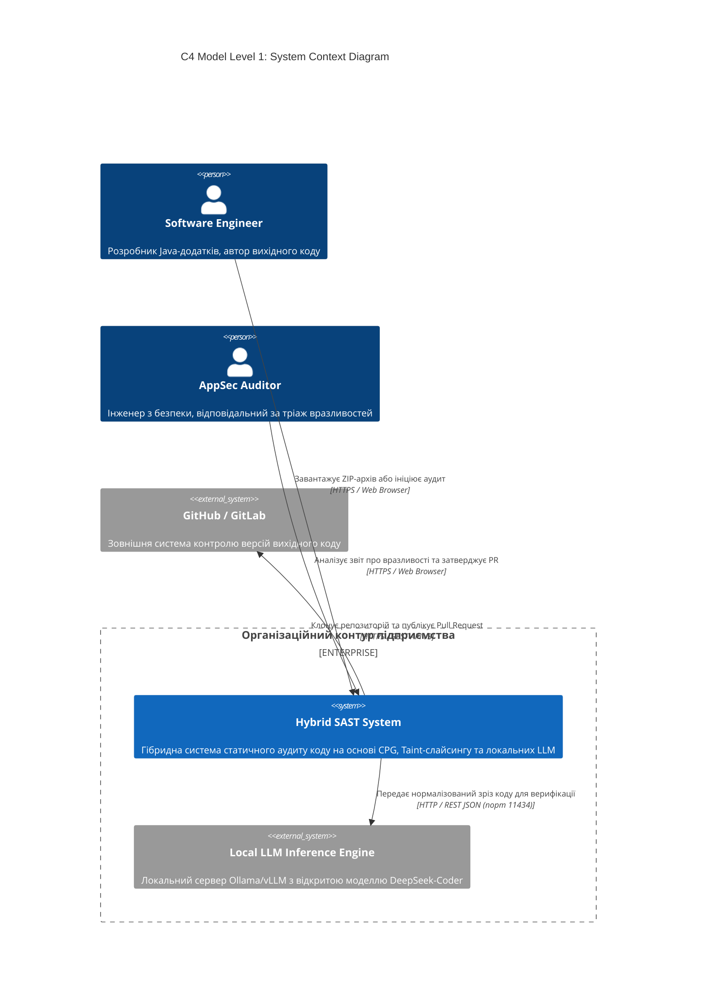
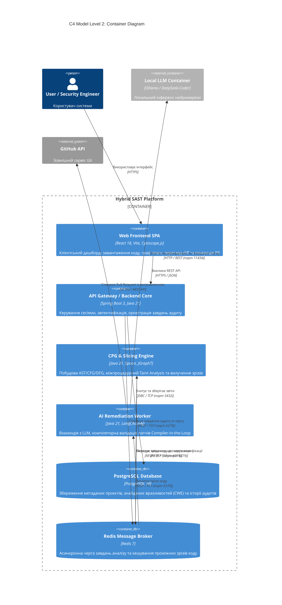

# РОЗДІЛ 2. ПРОЄКТУВАННЯ АРХІТЕКТУРИ СИСТЕМИ

## 2.1. Контекстне та контейнерне моделювання системи (C4 Model: Levels 1–2)
Архітектурне проєктування системи виконано за індустріальною методологією Саймона Брауна (C4 Model) із застосуванням парадигми Architecture-as-Code у нотації Mermaid.js.

### 2.1.1. Рівень 1: Діаграма системного контексту (System Context Diagram)
Діаграма відображає межі взаємодії гібридного статичного сканера з ключовими користувачами та зовнішніми хмарними сервісами.

* **Опис вузлів контексту:**
  * **Hybrid SAST System** — спроєктована система, що реалізує вимоги [SRS-FUN-01](../srs.md#2-functional-requirements) щодо прийому коду та [SRS-NFR-SEC-01](../srs.md#3-non-functional-requirements) щодо повної локальної ізоляції.
  * **GitHub / GitLab** — зовнішній провайдер коду, куди публікуються верифіковані Pull Request згідно з [SRS-FUN-08](../srs.md#2-functional-requirements).
  * **Local LLM Inference Engine** — ізольований контейнер локального інференсу, що виключає витік інтелектуальної власності.

---

### 2.1.2. Рівень 2: Діаграма контейнерів (Container Diagram)
Діаграма другого рівня розкриває внутрішній сервісний розподіл системи на окремо контейнеризовані Docker-модулі.

* **Трасування контейнерів:**
  * Контейнер **CPG & Slicing Engine** базується на інженерному рішенні [ADR-001](./adr/0001-choice-of-technology.md) щодо використання бібліотек Spoon та JGraphT.
  * Контейнер **AI Remediation Worker** забезпечує виконання вимоги [SRS-FUN-06](../srs.md#2-functional-requirements) та реалізує пісочницю компіляції [SRS-FUN-07](../srs.md#2-functional-requirements).
  * Контейнер **Redis Message Broker** забезпечує відмовостійкість та асинхронність за вимогою [SRS-NFR-REL-01](../srs.md#3-non-functional-requirements).

---

## 2.2. Компонентне моделювання критичного сервісу (C4 Model Level 3: Component)
Для деталізованого проєктування третього рівня обрано найбільш інтелектуально складний та обчислювальний контейнер — **CPG & Slicing Engine** (ядро компіляторного аналізу та формування зрізів коду). Проєктування здійснено відповідно до принципів Clean Architecture та SOLID.

```mermaid
C4Component
    title C4 Model Level 3: Component Diagram (CPG & Slicing Engine)

    Container(redisBroker, "Redis Task Queue", "Redis 7", "Черга вхідних завдань сканування")
    Container(remediationQueue, "Redis Slice Queue", "Redis 7", "Черга передачі зрізів у ШІ-воркер")

    Container_Boundary(engineBoundary, "CPG & Slicing Engine (Clean Architecture)") {
        Component(inboundConsumer, "AnalysisTaskConsumer", "Spring AMQP / Redis Listener", "Вхідний адаптер: зчитує повідомлення на аудит репозиторію")
        Component(inputValidator, "TaskPayloadValidator", "Spring Validation", "Валідує коректність структури запиту та наявність прав доступу")
        Component(errorHandler, "GlobalAnalysisErrorHandler", "Spring Exception Handler", "Перехоплює винятки парсингу, скеровує помилки в DLQ")

        Component(coordinator, "AnalysisWorkflowCoordinator", "Application Service", "Координує послідовність етапів: парсинг -> CPG -> Taint -> Slicing")

        Component(astBuilder, "SpoonAstModelBuilder", "Domain Service", "Розбирає код на базі Spoon JDT, генерує семантичну AST-модель")
        Component(cfgBuilder, "ControlFlowGraphBuilder", "Domain Service", "Будує внутрішньопроцедурний граф потоку керування (CFG)")
        Component(dfgBuilder, "DataFlowGraphBuilder", "Domain Service", "Будує ланцюжки залежності даних (Def-Use Chains, DFG)")
        Component(cpgIntegrator, "CodePropertyGraphIntegrator", "Domain Service", "Об'єднує AST, CFG та DFG в єдиний мультиграф JGraphT")
        Component(taintAnalyzer, "InterproceduralTaintAnalyzer", "Domain Service", "Трасує шлях від Source до Sink за правилами CWE")
        Component(slicer, "ContextualProgramSlicer", "Domain Service", "Вирізає мінімальний залежний зріз коду (15-30 рядків)")

        Component(outboundPublisher, "SlicePayloadPublisher", "Outbound Infrastructure Adapter", "Серіалізує зріз коду та публікує в Redis для AI Worker")
    }

    Rel(redisBroker, inboundConsumer, "Отримує повідомлення на сканування", "RESP / TCP")
    Rel(inboundConsumer, inputValidator, "Передає сирий payload на валідацію", "Internal Java Call")
    Rel(inputValidator, coordinator, "Ініціює пайплайн аналізу", "Method Call")
    Rel(coordinator, errorHandler, "Реєструє обробники аварійних ситуацій", "Exception Handling")

    Rel(coordinator, astBuilder, "Запитує побудову AST-моделі", "Interface Call / DI")
    Rel(astBuilder, cfgBuilder, "Передає AST-дерева методів", "Java Objects")
    Rel(astBuilder, dfgBuilder, "Передає таблицю символів та змінні", "Java Objects")
    Rel(cfgBuilder, cpgIntegrator, "Інтегрує ребра керування", "JGraphT Graph")
    Rel(dfgBuilder, cpgIntegrator, "Інтегрує ребра даних", "JGraphT Graph")

    Rel(coordinator, taintAnalyzer, "Запускає пошук маршрутів зараження", "Method Call")
    Rel(cpgIntegrator, taintAnalyzer, "Надає CPG-структуру для аналізу", "Graph Traversal")
    Rel(taintAnalyzer, slicer, "Передає виявлені координати Source-Sink", "Method Call")
    Rel(slicer, outboundPublisher, "Передає вирізаний зріз коду", "DTO")
    Rel(outboundPublisher, remediationQueue, "Публікує зріз для LangChain4j", "RESP / TCP")
```

* **Опис архітектурної дисципліни шарів:**
  * **Inbound Layer:** Компоненти `AnalysisTaskConsumer`, `TaskPayloadValidator` та `GlobalAnalysisErrorHandler` гарантують валідацію вхідних даних та безпечну обробку винятків згідно з вимогою [SRS-NFR-REL-01](../srs.md#3-non-functional-requirements).
  * **Domain Layer:** Сервіси `SpoonAstModelBuilder`, `CodePropertyGraphIntegrator` та `InterproceduralTaintAnalyzer` повністю ізольовані від зовнішніх фреймворків і реалізують алгоритмічне ядро системи за рішенням [ADR-001](./adr/0001-choice-of-technology.md).
  * **Outbound Layer:** Адаптер `SlicePayloadPublisher` відповідає за передачу даних до наступного контейнера через чергу.

---

## 2.3. Документування архітектурних рішень (ADR)
Усі ключові технологічні компроміси зафіксовані в офіційних документах архітектурних рішень у каталозі `docs/adr/`:
* [ADR-001: Вибір технологічного стеку для синтаксичного розбору, побудови CPG та слайсингу Java-коду](./adr/0001-choice-of-technology.md) — обґрунтування вибору бібліотек Spoon та JGraphT перед альтернативами JavaParser та Joern.
