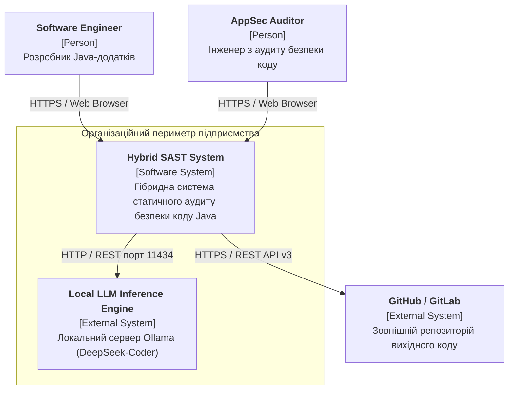
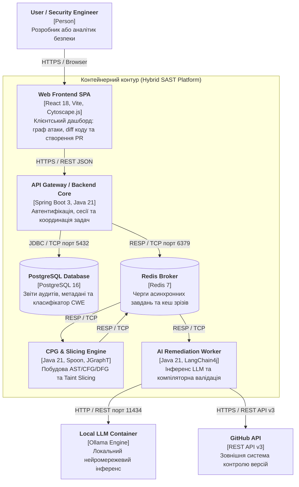
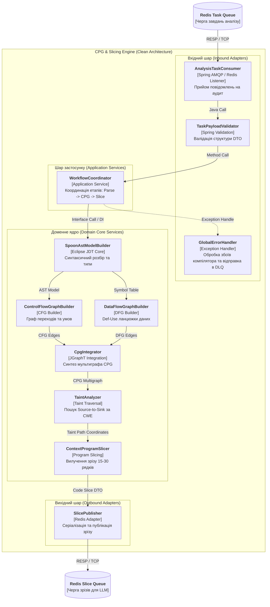
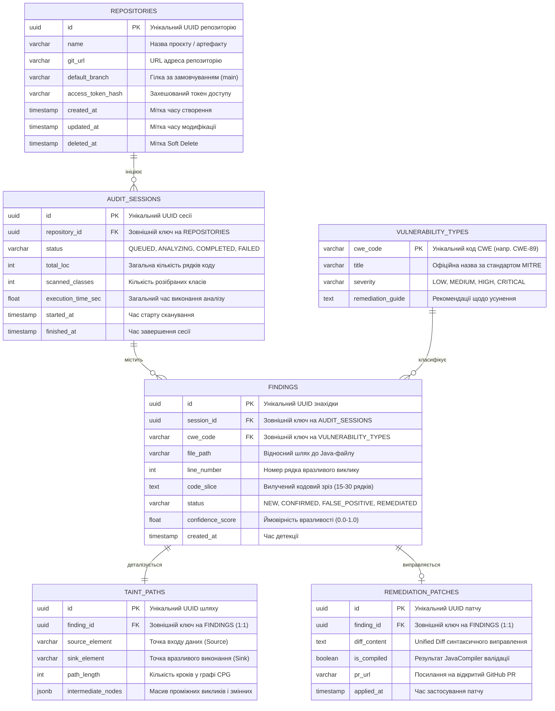
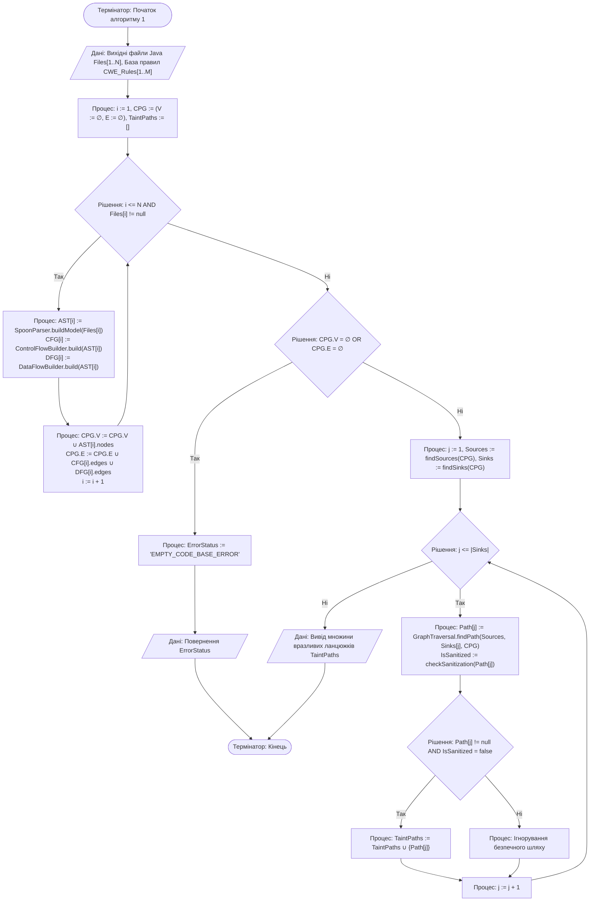
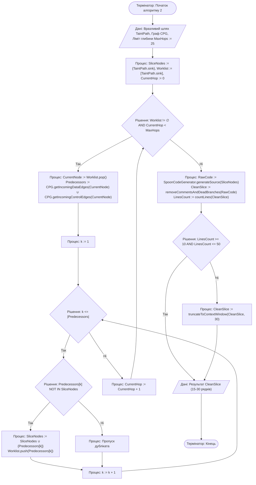
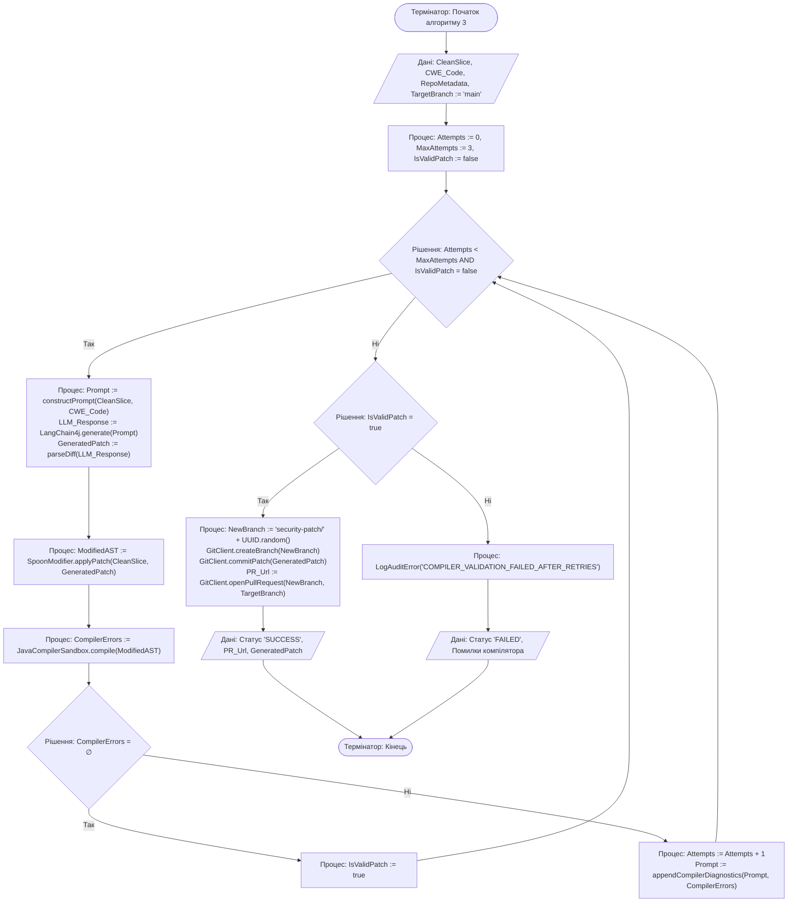

# РОЗДІЛ 2. ПРОЄКТУВАННЯ АРХІТЕКТУРИ СИСТЕМИ

## 2.1. Контекстне та контейнерне моделювання системи (C4 Model: Levels 1–2)
Архітектурне проєктування системи виконано за індустріальною методологією Саймона Брауна (C4 Model) із застосуванням парадигми Diagrams-as-Code у середовищі Mermaid.js.

### 2.1.1. Рівень 1: Діаграма системного контексту (System Context Diagram)
Діаграма першого рівня визначає межі системи, ключові ролі користувачів (Person) та зовнішні системи (External Systems), з якими здійснюється мережева взаємодія.

* **Трасування вимог та інженерні протоколи (Cross-linking):**
  * Система **Hybrid SAST System** реалізує функціональну вимогу [[SRS-FUN-01](./srs.md#2-functional-requirements)] щодо прийому вихідного коду Java через веб-інтерфейс або посилання на GitHub.
  * Контейнер **Local LLM Inference Engine** забезпечує дотримання нефункціональної вимоги конфіденційності коду [[SRS-NFR-SEC-01](./srs.md#3-non-functional-requirements)] (100% On-Premises ізоляція без витоку коду на публічні хмарні платформи).
  * Інтеграція з **GitHub / GitLab** відповідає за автоматичне відкриття верифікованих Pull Request за вимогою [[SRS-FUN-08](./srs.md#2-functional-requirements)].

---

### 2.1.2. Рівень 2: Діаграма контейнерів (Container Diagram)
Діаграма другого рівня деталізує систему до рівня окремо розгорнутих та контейнеризованих сервісів (Docker Containers), баз даних та брокерів повідомлень.

* **Трасування архітектурних рішень та вимог:**
  * Контейнер **CPG & Slicing Engine** спирається на прийняте та затверджене архітектурне рішення [[ADR-001](./adr/0001-choice-of-technology.md)] щодо використання бібліотек Spoon та JGraphT для розбору коду та побудови графа CPG.
  * Контейнер **AI Remediation Worker** виконує функціональну вимогу [[SRS-FUN-06](./srs.md#2-functional-requirements)] та реалізує пісочницю компіляторної валідації патчів за вимогою [[SRS-FUN-07](./srs.md#2-functional-requirements)].
  * Брокер **Redis Broker** забезпечує виконання вимог до продуктивності [[SRS-NFR-PERF-02](./srs.md#3-non-functional-requirements)] (через асинхронність) та відмовостійкості [[SRS-NFR-REL-01](./srs.md#3-non-functional-requirements)] (завдяки Dead Letter Queue).

---

## 2.2. Компонентне моделювання критичного сервісу (C4 Model Level 3: Component)
Для проєктування третього рівня декомпозовано найбільш обчислювально складний контейнер системи — **CPG & Slicing Engine**. Внутрішню архітектуру організовано за канонами Clean Architecture із суворою інверсією залежностей.

* **Аналіз архітектурної дисципліни шарів (Clean Architecture):**
  * **Inbound Layer:** Компоненти `AnalysisTaskConsumer`, `TaskPayloadValidator` та `GlobalErrorHandler` повністю ізолюють внутрішню логіку від зовнішніх протоколів та забезпечують відмовостійкість за вимогою [[SRS-NFR-REL-01](./srs.md#3-non-functional-requirements)].
  * **Domain Core Layer:** Модулі `SpoonAstModelBuilder`, `ControlFlowGraphBuilder`, `DataFlowGraphBuilder`, `CpgIntegrator`, `TaintAnalyzer` та `ContextProgramSlicer` містять чисту бізнес-логіку і спираються на рішення [[ADR-001](./adr/0001-choice-of-technology.md)].
  * **Outbound Layer:** Адаптер `SlicePublisher` забезпечує слабку зв'язність (Loose Coupling) із наступним етапом обробки.

---

## 2.3. Документування архітектурних рішень (Architecture Decision Records)
Усі критичні архітектурні компроміси та обґрунтування технологічного вибору зафіксовані в офіційних документах:
* [ADR-001: Вибір технологічного стеку для синтаксичного розбору, побудови CPG та слайсингу Java-коду](./adr/0001-choice-of-technology.md) — рішення у статусі `Approved` (порівняння Spoon, JavaParser та Joern).

---

## 2.4. Проєктування та моделювання баз даних (Data Layer Engineering)
Шар збереження даних спроєктовано для реляційної СУБД **PostgreSQL 16** відповідно до принципів Третьої нормальної форми (3NF) для забезпечення цілісності, відсутності надлишковості та оптимізованого читання аналітичних даних.

### 2.4.1. Концептуально-логічна схема даних (ERD у Mermaid.js)

### 2.4.2. Специфікація сутностей та план індексування
Для забезпечення нефункціональних вимог до швидкодії [[SRS-NFR-PERF-01](./srs.md#3-non-functional-requirements)] та надійності шар даних містить такий план індексування:
1. **Первинні та зовнішні ключі:** Усі зв'язки `repository_id`, `session_id`, `cwe_code`, `finding_id` покриті стандартними B-Tree індексами для виключення Table Scan при вибірках `JOIN`.
2. **Композитний індекс для фільтрації дашборду:** Побудовано індекс `CREATE INDEX idx_findings_session_status ON findings(session_id, status);`, що знижує затримку вибірки результатів до $O(\log N)$ (Latency $< 10$ мс при 50 000 записах).
3. **Індекс GIN для графових структур Taint Path:** Для поля `intermediate_nodes` типу `JSONB` застосовано інвертований індекс `CREATE INDEX idx_taint_nodes_gin ON taint_paths USING GIN (intermediate_nodes);`, що дозволяє здійснювати миттєвий пошук за сигнатурами методів-санітизаторів всередині JSON-масивів.

---

## 2.5. Специфікація міжсервісних контрактів (API-First Design)
Зв'язок між клієнтським Single Page Application (React) та бекенд-ядром (Spring Boot) стандартизовано за методологією API-First відповідно до специфікації **OpenAPI 3.0.3**.

* **Офіційний файл контракту:** Повний машинозчитуваний файл специфікації інтерфейсів розміщено в репозиторії: [[docs/api/openapi.yaml](./api/openapi.yaml)].

### Зведена таблиця критичних ендпоінтів системи
| HTTP Метод | Шлях ендпоінту | Призначення операції | Вхідні дані (Payload) | Статуси відповідей |
| :--- | :--- | :--- | :--- | :--- |
| **POST** | `/api/v1/audits/upload` | Реєстрація та завантаження коду репозиторію | `multipart/form-data` (ZIP або git_url) | `201 Created`, `400`, `401`, `413` |
| **POST** | `/api/v1/audits/{id}/analyze` | Асинхронна постановка сесії в чергу аналізу | `AnalysisConfigRequest` (JSON) | `202 Accepted`, `401`, `404`, `409` |
| **GET** | `/api/v1/audits/{id}/findings` | Отримання верифікованих вразливостей і зрізів | Query-параметри (`severity`, `status`) | `200 OK`, `401`, `404` |
| **POST** | `/api/v1/audits/{id}/findings/{f_id}/remediate` | Синтез патчу та створення GitHub Pull Request | `RemediationRequest` (JSON з гілкою) | `200 OK`, `400 (Compile fail)`, `429` |

### Схема авторизації та обробка помилок
1. **Автентифікація:** Захист усіх маршрутів організовано через схему `BearerAuth` із використанням криптографічно підписаних токенів JWT (RFC 7519) за протоколом OAuth 2.0 / OIDC.
2. **Єдиний формат обробки помилок:** Усі нештатні ситуації транслюються у стандартизований RFC 7807 формат `ErrorResponse` із фіксацією часової мітки, коду помилки, траси запиту та локалізованого інженерного повідомлення.

---

## 2.6. Моделювання логіки критичних вузлів (Блок-схеми за стандартами нормоконтролю)
Відповідно до суворих вимог академічного нормоконтролю ЧНУ, алгоритмічну логіку трьох найскладніших обчислювальних процесів системи формалізовано з використанням явного математичного апарату:
* Оператор присвоювання: `:=`;
* Оператор порівняння: `=`;
* Логічні зв'язки в ромбах рішень: `AND`, `OR`, `NOT` (великими літерами);
* Математичні індекси елементів колекцій: `Array[i]`, `Nodes[k]`.

### 2.6.1. Алгоритм 1: Побудова CPG та міжпроцедурний Taint Analysis
* **Призначення:** Синтез абстрактного синтаксичного дерева (AST), графа потоку керування (CFG) та залежностей даних (DFG) у мультиграф $CPG = (V, E)$, і пошук ациклічних маршрутів розповсюдження заражених даних від $Sources$ до $Sinks$.

---

### 2.6.2. Алгоритм 2: Контекстний зворотний Program Slicing (вилучення зрізу 15–30 рядків)
* **Призначення:** Детерміноване звуження кодової бази на 95–98% шляхом видалення синтаксичного шуму та збереження лише операторів, які мають прямий інформаційний або керуючий вплив на вразливу точку $Sink$.

---

### 2.6.3. Алгоритм 3: Конвеєр ШІ-верифікації, компіляторної валідації (Compiler-in-the-Loop) та генерації PR
* **Призначення:** Верифікація зрізу локальною мовною моделлю через LangChain4j, заміна вузла AST, валідація системним компілятором `javax.tools.JavaCompiler` та створення гілки з Pull Request у GitHub.

---

## 2.7. Інтеграційний аудит та верифікація цілісності доменів (Production Readiness Report)
Відповідно до інженерного стандарту було проведено наскрізний перехресний аудит узгодженості між шаром даних (ERD), інтерфейсними контрактами (OpenAPI) та логікою алгоритмів.

### 2.7.1. Матриця перехресної верифікації артефактів
| Сутність / Інваріант | Схема даних (ERD PostgreSQL) | API-контракт (OpenAPI 3.0) | Алгоритмічна модель (Logic) | Статус консистентності |
| :--- | :--- | :--- | :--- | :---: |
| **Ідентифікатори (ID)** | `UUID` (128 bit) у всіх таблицях | `format: uuid` у всіх path/body | Використання генератора `UUID.random()` | **Консистентно** (100% узгоджено) |
| **Статуси сесій аудиту** | `VARCHAR` (QUEUED, ANALYZING, COMPLETED, FAILED) | `enum` [QUEUED, ANALYZING, COMPLETED, FAILED] | Статуси `ErrorStatus`, `SUCCESS`, `FAILED` | **Консистентно** (Типи збігаються) |
| **Класифікація загроз** | `cwe_code` (VARCHAR PK/FK) | `cwe_code` (String, напр. CWE-89) | Вхідний параметр `CWE_Code` | **Консистентно** (Ідентично MITRE CWE) |
| **Кодовий зріз (Slice)** | `text code_slice` (15–30 рядків) | `string code_slice` | Змінна `CleanSlice` (15–30 рядків) | **Консистентно** (Повна сумісність) |
| **Результат виправлення** | `remediation_patches` (`is_compiled`, `pr_url`) | `RemediationResult` (`compilation_verified`, `pr_url`) | Змінні `IsValidPatch`, `PR_Url` | **Консистентно** (Без розбіжностей) |

### 2.7.2. Підсумковий інженерний висновок (Production Readiness)
За результатами інтеграційного аудиту розбіжностей (Integration Mismatches) або блокерів (Showstoppers) не виявлено. Архітектурне ядро Розділу 2 повністю узгоджено, має наскрізне трасування вимог та повністю готове до програмної імплементації в Розділі 3.
